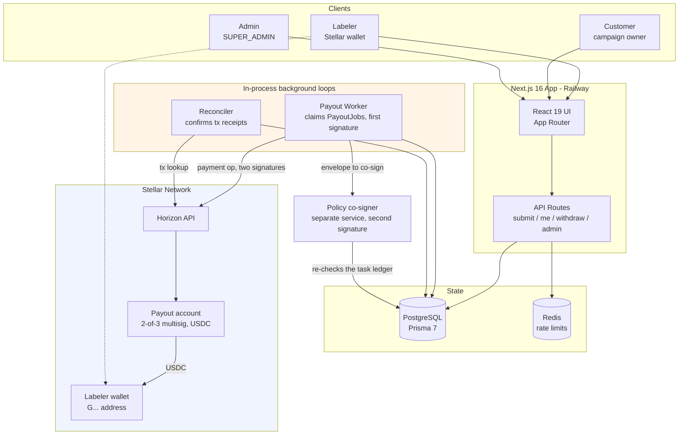
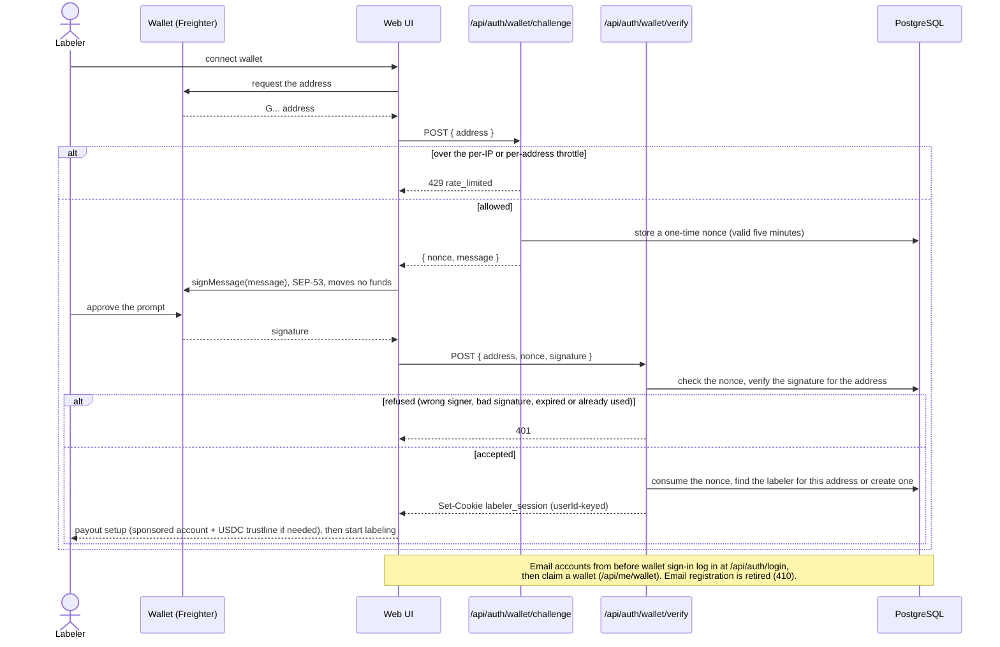
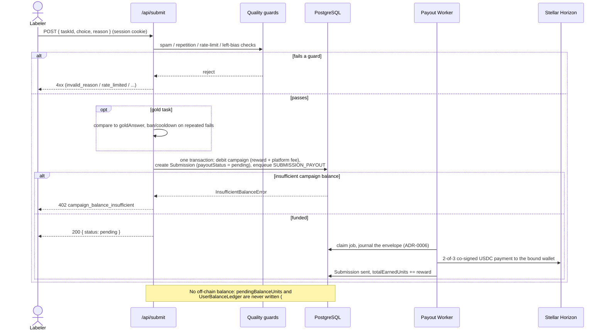
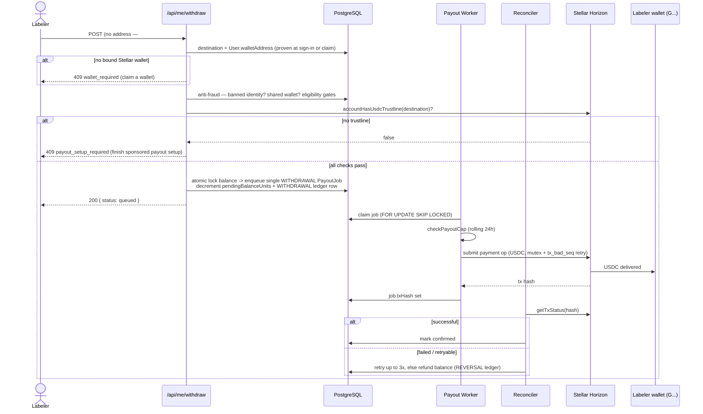

# Centient — Train AI, cent by cent.

[](https://github.com/artisam-centient/centient/actions/workflows/ci.yml?query=branch%3Adevelop)

Centient is a **data labeling platform** where people earn **USDC on Stellar** by
ranking AI-generated response pairs. AI developers upload output pairs to be judged
by a human crowd; built-in quality guards (gold tasks, rate limiting, spam and bias
detection, inter-annotator agreement) keep the results reliable. Each accepted answer
is paid on-chain, straight to the labeler's Stellar wallet, through a 2-of-3 multisig
payout (see [ADR-0005](docs/adr/0005-submit-enqueues-worker-pays.md)).

**Goal:** Make AI alignment through human feedback accessible and instantly
rewarding for anyone with an internet connection — no bank account required.

| | |
|---|---|
| **Live app** | [beta.centient.work](https://beta.centient.work), built from the `staging` branch. [`/api/version`](https://beta.centient.work/api/version) names the deployed commit in this repository |
| **Docs** | [centient.gitbook.io/centient-docs](https://centient.gitbook.io/centient-docs/): weekly reports, a page per deliverable, every transaction. The source is [`docs/instawards/`](docs/instawards/README.md) |
| **Network** | Stellar **testnet** only. Every account and transaction in this project holds no real value |
| **Funding** | Stellar Development Foundation Instawards, Philippines chapter. Month 1 ran 7 September – 6 October 2026 |

---

## Proof of work

Month 1 shipped four deliverables. Each passed an independent QA gate on a named
build, and every link below is public: commits in this repository, accounts and
transactions on stellar.expert, and evidence files under `docs/`.

| Deliverable | What shipped | QA verdict | Evidence |
|---|---|---|---|
| **D1** Instant USDC reward rail | A 2-of-3 multisig payout account, an independent policy co-signer, a daily cap at both signers and a hot/cold reserve | Passed 28/28 at [`263be4c`](https://github.com/artisam-centient/centient/commit/263be4cd5ab06103d965044c6a8bd3c40678f308) | [D1 page](docs/instawards/deliverables/d1.md) · [a two-signature, fee-bumped payout](https://stellar.expert/explorer/testnet/tx/5083dd72a16bfa749c6b302c293e931939acd70cc52f63586443921d60698206) |
| **D2** Wallet-native onboarding | Freighter sign-in by signed challenge (SEP-53), plus a sponsored account and USDC trustline for wallets with no XLM | Passed at [`8f660cc`](https://github.com/artisam-centient/centient/commit/8f660cc632f1c868a41618434a1c169dc0edabcc): 38 of 40 executed, 2 accepted as residual | [D2 page](docs/instawards/deliverables/d2.md) · [evidence files](docs/instawards/reference/evidence.md#evidence-files) |
| **D3** End-to-end contributor loop | Connect, rank, validate, co-sign, pay and reconcile, with no custodial balance | Passed at [`1fde77d`](https://github.com/artisam-centient/centient/commit/1fde77d539ca040bb12c07df0c82dad5c8cf3a58) | [D3 page](docs/instawards/deliverables/d3.md) · [reconcile report](docs/design/specs/2026-09-24-d3-reconcile-report.md) |
| **D4** Reconciliation and public release | Failure-injection tests, the volume proof and a demo | Passed 35/36 at [`e9c28ad`](https://github.com/artisam-centient/centient/commit/e9c28ad9537e2e72d0dd33d374c7338a9094aaec) | [D4 page](docs/instawards/deliverables/d4.md) · [volume proof](docs/design/specs/2026-09-28-d4-volume-proof.md) · [demo video](https://drive.google.com/drive/folders/11SiPEsUuHDKGgJcfm3yWfejjQuOElUD9) |

The [volume proof](docs/design/specs/2026-09-28-d4-volume-proof.md) reconciles
**122 testnet USDC payouts to 25 unique wallets** (22–28 September). Every one
carries two signatures inside a fee bump, with **0 unreconciled and 0
duplicates**. The [evidence index](docs/instawards/reference/evidence.md) lists
every account and transaction in one place, with full hashes.

Work continued after Month 1. XP, daily streaks, tiers and a weekly board shipped
on 12 October ([ADR-0010](docs/adr/0010-xp-is-never-money.md),
[ADR-0011](docs/adr/0011-tiers-gate-access-never-pay.md),
[ADR-0012](docs/adr/0012-weekly-board-and-event-codes.md)), and contributors can
sign in with the [Lantern](docs/lantern-integration.md) Android wallet.

### Testnet accounts

| Account | Role |
|---|---|
| [`GCP34RITQIVSLHS5T4XZRENIBUS3T7FHL3VSR24GK7HPMHGAAKWK4BUO`](https://stellar.expert/explorer/testnet/account/GCP34RITQIVSLHS5T4XZRENIBUS3T7FHL3VSR24GK7HPMHGAAKWK4BUO) | Payout account (hot wallet). 2-of-3 multisig, thresholds 2/2/2. Every reward is paid from here |
| [`GC5UOKLU6J2EROZYYP2I23ZEF4YF42TGGRNQMMTGOJGJ7NOCH3TTR4A6`](https://stellar.expert/explorer/testnet/account/GC5UOKLU6J2EROZYYP2I23ZEF4YF42TGGRNQMMTGOJGJ7NOCH3TTR4A6) | Cold reserve. 2-of-3 multisig that refills the payout account |
| [`GBBD47IF6LWK7P7MDEVSCWR7DPUWV3NY3DTQEVFL4NAT4AQH3ZLLFLA5`](https://stellar.expert/explorer/testnet/account/GBBD47IF6LWK7P7MDEVSCWR7DPUWV3NY3DTQEVFL4NAT4AQH3ZLLFLA5) | USDC issuer on testnet (Circle) |

---

## Tech Stack

| Layer | Choice |
|---|---|
| Framework | Next.js 16 (App Router) + React 19 |
| Language | TypeScript 5.4 |
| Styling | Tailwind CSS 4 |
| Database | PostgreSQL + Prisma 7 |
| **Settlement** | **Stellar** classic (Horizon) payments via `@stellar/stellar-sdk` 16 |
| **Asset** | **USDC** — Circle's Stellar-issued asset (7-decimal units) |
| Wallet | Freighter — extension via `@stellar/freighter-api`, mobile app via WalletConnect v2. [Lantern](docs/lantern-integration.md) on Android. Albedo descoped, see ADR-0003 |
| Rate limiting | Redis (`ioredis`) |
| Email | Resend |
| Observability | Sentry, PostHog |
| Deploy | Railway |

---

## Why there is no smart contract (and no testnet contract address)

**Centient ships no Soroban smart contract, so there is no contract testnet
address to publish.** This is a deliberate architectural decision, not an omission.

Payout in Centient is a single, simple operation: a trusted platform hot wallet
sends a fixed-asset (USDC) transfer to a labeler's address. Stellar's **native
classic `payment` operation** already does exactly that — atomically, with sub-5-second
finality and fees on the order of a fraction of a cent. There is no custom
on-chain state, no escrow logic, and no multi-party settlement that would justify
executable on-chain code.

Choosing classic Horizon payments over a Soroban contract means:

- **No custody logic on-chain to get wrong.** The riskiest part of any payout system
  is the money-moving code; a `payment` op is battle-tested protocol primitive, not
  bespoke WASM we would have to write, audit, and secure.
- **No WASM build, audit, contract rent, or TTL/bump management.** Soroban contracts
  incur storage rent and time-to-live upkeep; a payment op has none of that.
- **USDC is already on-chain.** We pay in Circle's issued USDC asset (referenced by
  its *issuer account*, not a contract we deployed), so there is nothing for us to
  mint or manage.
- **Smaller attack surface + faster to ship.** Fewer moving parts, cheaper per-tx,
  and a mainnet cutover that is a config-only network swap.

The one Stellar-native constraint we *do* handle is **trustlines**: a recipient must
hold a USDC trustline before they can be paid (a payment to an untrusted account
fails with `op_no_trust`). Payout setup establishes it when a wallet is bound, and we
optionally platform-sponsor the trustline reserve (see `lib/sponsored-trustline.ts`).

> **Network:** everything runs on Stellar **testnet** by default and flips to
> **mainnet** by changing `STELLAR_NETWORK` + the USDC issuer env — no code change.

---

## System Architecture

Centient is a single Next.js deployment (web + API routes) backed by PostgreSQL and
Redis, with two long-lived background loops — the **payout worker** and the
**reconciler** — that run *in-process* inside the web server (see
`instrumentation.ts`) unless split out with `RUN_WORKERS=false`. Jobs are claimed
with `FOR UPDATE SKIP LOCKED`, so the loops stay correct even when the app is scaled
horizontally.

No single key or server can move money. A payout needs two of the payout account's
three signatures: the web process holds one, and the **policy co-signer**
(`services/cosigner`, its own Railway service with its own database role) holds
another. The co-signer re-derives each payment's amount and destination from the
task ledger and checks its own daily cap before it signs. The
[payout rail](docs/instawards/architecture/payout-rail.md) walks through one payout
step by step.



### The two-object identity model

The core design splits two things that used to be the same object:

- **Identity** — a labeler is a `User.id` (UUID). They sign in by connecting a Stellar
  wallet and signing a one-time challenge (SEP-53); the session is keyed to
  `User.id`, never to the address. Accounts made with email before wallet sign-in
  log in with email + password, then claim a wallet (#30) and sign in with it from
  then on.
- **Payout target** — the Stellar `G…` address the account proved at wallet sign-in or
  claim (#30). Every payout goes there; none is typed at payout time.

Earnings are paid **instantly**: each accepted answer enqueues one `SUBMISSION_PAYOUT`
job, and the payout worker sends that reward to the bound wallet on-chain, raising
`User.totalEarnedUnits`. Nothing is held off-chain on the labeler's behalf.

> **Retired: accumulate-then-withdraw.** Answers used to accrue to an off-chain
> balance (`User.pendingBalanceUnits`, audited via `UserBalanceLedger`) that the
> labeler withdrew as one lump sum. Nothing accrues any more. Balances earned before
> instant payout can still be withdrawn, with no minimum, until they reach zero (#39,
> [ADR-0007](docs/adr/0007-retire-accumulate-then-withdraw.md)).

### Money & precision

USDC on Stellar uses integer **units** at 7 decimal places (1 USDC = 10,000,000
units). All amounts are stored and computed as `BigInt` units; conversion to the
decimal string the SDK's `payment` op expects is centralized in `lib/stellar/config.ts`
(`usdcToUnits` / `unitsToUsdcString`) using only string/BigInt arithmetic — never
floating point.

---

## Sequence Diagrams

### 1. Labeler sign-in (Stellar wallet, signed challenge)



### 2. Earning — submit an answer (paid on-chain, instantly)



### 3. Legacy withdrawal — one on-chain USDC lump sum

Legacy only (#39, [ADR-0007](docs/adr/0007-retire-accumulate-then-withdraw.md)). It is
shown only while an account still holds a balance accrued before instant payout, and
no minimum applies. A zero balance is refused with `409 no_balance`.



---

## Getting Started

### Prerequisites

- Node.js 22.12+
- pnpm (`npm i -g pnpm`)
- Docker (for local PostgreSQL)
- A funded Stellar **testnet** account for the platform hot wallet
  (generate a keypair, fund via [friendbot](https://friendbot.stellar.org),
  add a USDC trustline)

### Setup

```bash
git clone https://github.com/artisam-centient/centient.git
cd centient
pnpm install
pnpm run setup   # generates .env.local, starts Postgres, migrates + seeds
pnpm dev
```

Use `pnpm run setup`, not `pnpm setup`: the short form runs pnpm's own built-in
`setup` command, which edits your shell profile instead of running this script.

`pnpm run setup` produces a bootable `.env.local` — every required key is generated or
stubbed so no route 500s on a missing value. It's **idempotent and non-destructive**:
re-running never overwrites a real secret you've already set. It then starts the `db`
container, applies migrations, and seeds test data.

**Before real payouts work**, set the Stellar keys in `.env.local`:

| Key | Meaning |
|---|---|
| `STELLAR_NETWORK` | `testnet` (default) or `public` (mainnet) |
| `NEXT_PUBLIC_STELLAR_NETWORK` | The same value again, for the browser. Only `NEXT_PUBLIC_*` vars reach the client bundle, so without it the signing code in the browser assumes testnet |
| `NEXT_PUBLIC_WALLETCONNECT_PROJECT_ID` | Optional. Enables the Freighter **mobile app**; leave unset to stay extension-only. Free from [dashboard.reown.com](https://dashboard.reown.com) — confirm it with `pnpm walletconnect:verify` |
| `STELLAR_PLATFORM_ACCOUNT` | `G…` public key of the payout account. Required for wallet health and payout configuration — reading balances and planning refills needs no signing key |
| `STELLAR_SPONSOR_SECRET` | `S…` seed that sponsors recipients' USDC trustlines. **Must not be a signer on the payout account** (F-01); it needs XLM for reserves and no payout authority |
| `STELLAR_OPS_SIGNER_SECRET` | `S…` seed of the ops signer — signature #1 of the 2-of-3 payout. This is the *only* payout-account seed a deployment may hold |
| `STELLAR_PLATFORM_SECRET` | `S…` seed of the payout account master. **Do not set this alongside `STELLAR_OPS_SIGNER_SECRET`** — one deployment holding two of the three seeds meets the threshold on its own and the payout path refuses to start (F-01) |
| `STELLAR_USDC_ISSUER` | USDC issuer `G…` (testnet default is Circle's test USDC) |

Once seeded, log in to test every area. These are **local-development defaults
only** ([ADR-0002](docs/adr/0002-seeded-credentials-accepted-on-testnet-qa.md)):
they are published and burned, the seed refuses them against any non-local
database, and no deployed environment accepts them.

| Account | Email | Password | Access |
|---------|-------|----------|--------|
| Admin | `admin@centient.work` | `GoCent!123` (or `ADMIN_SEED_PASSWORD`) | `SUPER_ADMIN` — full admin dashboard |
| Labeler | `demo@centient.work` | `Demo!123` (or `DEMO_LABELER_PASSWORD`) | Contributor, email/password login — seeded locally only |
| Customer | `centient@centient.work` | your `INTERNAL_CUSTOMER_PASSWORD` | `CUSTOMER` — campaign owner views; seeded only when that variable is set |

> Not using Docker for Postgres? Run `pnpm setup:env` (env only), point
> `DATABASE_URL` at your own database, then `pnpm db:deploy && pnpm db:seed`.
>
> Seeing `P3005 — database schema is not empty`? Your local DB predates the
> migration history. Rebuild it cleanly with `pnpm db:reset` (destructive).

### Connecting a wallet on mobile

`@stellar/freighter-api` only ever talks to the Freighter **browser extension**, and
no Stellar wallet ships an extension for mobile browsers — so on a phone the wallet
flows had nowhere to go but "install the browser extension", which no phone can do.

Freighter's mobile app speaks **WalletConnect v2** instead, so that is the second
transport. `lib/stellar/wallet.ts` picks between them: the extension whenever one
answers, otherwise the mobile app when `NEXT_PUBLIC_WALLETCONNECT_PROJECT_ID` is set.
Callers don't know which ran.

| | Extension | Mobile app |
|---|---|---|
| Transport | `@stellar/freighter-api` | WalletConnect v2, `stellar` namespace |
| Ownership proof | `signMessage` | `stellar_signMessage` (SEP-53 — byte-identical) |
| Trustline co-signature | `signTransaction` | `stellar_signXDR` |
| Chain | network passphrase | `stellar:testnet` / `stellar:pubnet` |

Two things to know when configuring it:

- **The networks must agree.** Freighter mobile rejects a request whose chain
  doesn't match the network the wallet is on, so `NEXT_PUBLIC_STELLAR_NETWORK` has
  to track `STELLAR_NETWORK`, and a contributor on mainnet Freighter can't sign
  against a testnet deployment (they get a "switch networks" message, not a
  silent failure).
- **The mobile wallet returns no signer address.** `stellar_signMessage` answers
  with a bare signature, so the extension's "did the right account sign this?"
  check has nothing to compare against. The transport verifies the signature
  against the expected address locally instead — a real check rather than a
  self-report.

On a phone the pairing is handed straight to the Freighter app via its deep link,
resolved from the WalletConnect registry rather than hardcoded — the wallet only
pairs from a URL carrying the redirect string it was built with, and that value
lives in its private CI config. When the registry can't answer, the prompt falls
back to `freighterwallet://` (the scheme Freighter registers with the OS, read
off its own build config) and always keeps a copy-the-link path visible, because
a deep link either switches apps or does nothing observable — there is no failure
event to recover from. On a desktop with no extension the same pairing renders as
a QR code for the app to scan.

Two details that decide whether this feels instant or broken:

- **The transport is resolved once per page.** `@stellar/freighter-api` detects
  the extension by posting a message and waiting for a content script to answer,
  and waits a hard-coded **2 seconds** before concluding there isn't one. Probing
  per call would cost about four seconds across a single mobile sign-in, so
  `resolveTransport()` memoizes. A newly installed extension only injects itself
  into a fresh page load, which starts the probe over anyway.
- **The connect button warms the path on mount.** `prepareWallet()` starts the
  relay SDK download, the WalletConnect handshake and the registry lookup while
  the contributor is still reading the screen. Without it all three land between
  the tap and the app opening.

Signing out drops the pairing as well as the session cookie: a WalletConnect
session is stored by the relay SDK and outlives the cookie, so without that the
next person on a shared phone would tap "Connect Freighter" and be signed back in
as the previous contributor.

### Going to mainnet

Not part of the current work: the deployment and every deliverable run on testnet
only. This records how the cutover would go.

The cutover is config-only: set `STELLAR_NETWORK=public` (and
`NEXT_PUBLIC_STELLAR_NETWORK=public`), point `STELLAR_USDC_ISSUER`
at Circle's mainnet USDC issuer, fund the platform account with real XLM (reserves +
fees) and USDC, add its trustline, then run one small smoke-test payout and verify it
on [stellar.expert](https://stellar.expert).

---

## Available Scripts

| Command | Description |
|---------|-------------|
| `pnpm run setup` | One-command dev setup: env + Postgres + migrate + seed |
| `pnpm setup:env` | Generate/repair `.env.local` only (idempotent) |
| `pnpm dev` | Start development server (workers run in-process) |
| `pnpm build` | Generate Prisma client and build for production |
| `pnpm start` | Start production server |
| `pnpm payout` | Run the payout worker standalone (with `RUN_WORKERS=false`) |
| `pnpm reconciler` | Run the receipt reconciler standalone |
| `pnpm test` | Run the vitest suite |
| `pnpm walletconnect:verify` | Check the Freighter-mobile project id against the live relay and registry |
| `pnpm typecheck` | Type-check without emitting |
| `pnpm db:migrate` | Run database migrations (dev) |
| `pnpm db:deploy` | Deploy migrations (production) |
| `pnpm db:seed` | Seed database with sample data |
| `pnpm db:studio` | Open Prisma Studio |
| `pnpm db:reset` | Reset database (warning: destructive) |

---

## Project Structure

```
├── app/                    # Next.js App Router pages + API routes
│   ├── api/submit          #   earn: validate answer -> enqueue its on-chain payout
│   ├── api/me/withdraw     #   legacy: withdraw a pre-#39 balance as one lump sum
│   ├── api/auth            #   wallet sign-in (signed challenge), legacy email login
│   └── admin               #   SUPER_ADMIN dashboard (campaigns, users, ops)
├── components/             # React components
├── lib/
│   ├── stellar/            #   config, client (payUsdc), balance, signature, wallet
│   ├── gamification/       #   XP, streaks, tiers, weekly board (never money)
│   ├── payout-worker.ts    #   claims PayoutJobs, submits payments, retries + refunds
│   ├── reconciler.ts       #   confirms tx receipts (sent -> confirmed)
│   ├── user-balance.ts     #   legacy off-chain balance (withdraw / reversal)
│   ├── campaign-balance.ts #   prepaid customer balance debit/credit/refund
│   ├── sponsored-trustline.ts  # platform-sponsored USDC trustlines (bounded)
│   └── ...                 #   quality, rate-limit, anti-fraud, withdrawal-eligibility
├── services/cosigner/      # independent policy co-signer (the second payout signature)
├── prisma/                 # Schema, migrations, seed scripts
├── scripts/                # Stellar account setup, reserve refill, reclaim, reconcile report
├── tests/                  # test helpers and the payments-lane suite
├── D2-QA-UNBLOCK/          # D2 QA reproduction kit and its evidence (Month 1)
├── instrumentation.ts      # boots in-process payout worker + reconciler
└── docs/
    ├── instawards/         #   sprint reports, deliverables, evidence index (the GitBook source)
    ├── adr/                #   architecture decision records
    ├── design/             #   design specs, implementation plans, evidence files
    └── *.md                #   runbooks, payout API, feature list
```

## Documentation

- **[Sprint book](docs/instawards/README.md)**, published at
  [centient.gitbook.io/centient-docs](https://centient.gitbook.io/centient-docs/):
  weekly reports, the four deliverables, [metrics](docs/instawards/reference/metrics.md),
  the [evidence index](docs/instawards/reference/evidence.md) and
  [open risks](docs/instawards/reference/risks.md).
- **Architecture:** the [payout rail](docs/instawards/architecture/payout-rail.md),
  [wallet identity](docs/instawards/architecture/wallet-identity.md) and the
  [decision records](docs/adr) (ADR-0001 to ADR-0012).
- **Operations:** runbooks for the [multisig accounts](docs/stellar-multisig-runbook.md),
  [payout failures](docs/stellar-payout-failure-runbook.md), the
  [cold reserve](docs/stellar-cold-reserve-runbook.md) and the
  [co-signer deployment](docs/cosigner-deployment.md), plus the
  [payout API](docs/payout-api.md).
- **Design specs:** [`docs/design/specs`](docs/design/specs), one per feature, with the
  Month-1 evidence files beside them.

## Supporting Links

- **Demo video:** [Drive folder](https://drive.google.com/drive/folders/1vpdG9uDyfMjMibSOdVLZG1SMn10hgl6j?usp=sharing).
  The captioned D4 demo (3:58) is in the [D4 folder](https://drive.google.com/drive/folders/11SiPEsUuHDKGgJcfm3yWfejjQuOElUD9)
- **Pitch deck:** [Drive folder](https://drive.google.com/drive/folders/1fum1zUZkCSWnntNUm6weRn_5XIyK-ovE?usp=sharing)

## License

MIT
</content>
</invoke>
